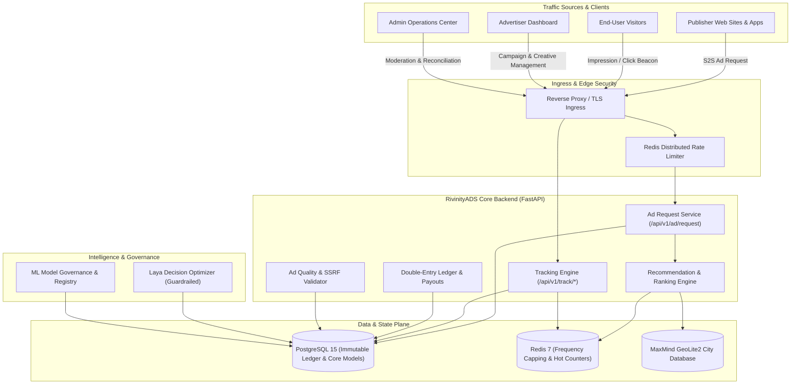

# RivinityADS (Bharattech Ads)

[](https://github.com/BHARATTECH-ECOSYSTEMS/RivinityADS/actions/workflows/ci.yml)
[](https://opensource.org/licenses/Apache-2.0)
[](https://www.python.org/)
[](https://nodejs.org/)
[](https://www.postgresql.org/)
[](https://redis.io/)

**RivinityADS** is a production-hardened, self-hosted, open-source digital advertising platform. Designed from the ground up for high-throughput, low-latency direct ad serving, multi-role tenant isolation, auditable double-entry billing, geographic & sector targeting, and modern publisher monetization.

---

## Architecture Overview



### Core Platform Pillars
1. **Direct Ad Serving Engine:** Sub-50ms p95 latency ad retrieval, budget pacing, sector/geographic targeting, frequency capping, and format-aware creative matching.
2. **Three-Role Portal:**
   - **Advertisers:** Campaign wizard, ad set budgeting, radius targeting, creative upload, and real-time performance analytics.
   - **Publishers:** Property verification (DNS TXT / HTML Meta tag), ad slot creation, inventory monetization, and payout tracking.
   - **Platform Operators (Admin):** SLA-tracked moderation queues, SSRF-safe destination audits, infrastructure health telemetry, and financial reconciliation.
3. **Auditable Double-Entry Financial Ledger:** Every advertiser credit, spend, reservation, refund, and publisher payout is recorded as an immutable transaction in PostgreSQL. Zero floating-point drift (`NUMERIC(12, 4)`) and zero race conditions under high concurrent load.
4. **Open Design Website Builder:** In-browser visual site builder with responsive canvas, revision history, and drag-and-drop Ad Slot palette for publishers.
5. **Guardrailed Optimizer (Laya):** Fail-closed decision optimization engine operating under strict human-in-the-loop controls (`suggestions_only` default, bounded bid increments, and daily spend limits).
6. **ML Governance & Model Registry:** Strict separation between lightweight CPU-bound serving and offline model training. Deterministic statistical serving baseline is authoritative; ML scoring operates under strict shadow evaluation and automated rollback to last-known-good artifacts.

---

## Security & Operational Invariants

The platform enforces strict non-negotiable security and reliability invariants:

- **Zero Plaintext Secrets:** Startup fails immediately in production if `LITEADS_AUTH__JWT_SECRET` or `LITEADS_TRACKING__SECRET` are absent or fewer than 32 characters.
- **Cryptographic Event Protection:** Impression, click, and conversion URLs are secured with HMAC-SHA256 signatures, tamper-proof payloads, and expiration timestamps.
- **Webhook Raw-Byte Verification:** Razorpay payment webhooks verify cryptographic signatures against the raw unparsed request payload before executing atomic balance credits.
- **DB-Level Concurrency & Idempotency:** Financial transactions and conversion attribution utilize database row locks (`SELECT ... FOR UPDATE`) and unique constraint deduplication to prevent double-billing and replay attacks.
- **Single Alembic Migration Head:** Linear database migration history strictly pinned to authoritative head `x3y4z5a6b7c8`.
- **Fail-Safe Serving Default:** Ad ranking defaults to statistical CTR/CVR scoring. Serving never fails open into unverified third parties or uncalibrated ML models.

---

## Quickstart

### Prerequisites
- Docker & Docker Compose (v2.20+)
- Python 3.11+ (for local backend development)
- Node.js 22+ & npm (for local frontend development)

### 1. Run with Docker Compose
```bash
# Clone the repository
git clone https://github.com/BHARATTECH-ECOSYSTEMS/RivinityADS.git
cd RivinityADS

# Copy environment template and configure secrets
cp .env.example .env.prod

# Start full production stack
docker compose -f backend/docker-compose.prod.yml up -d
```

### 2. Local Backend Development
```bash
# Set up Python virtual environment
python -m venv .venv
source .venv/bin/activate  # On Windows: .venv\Scripts\activate

# Install CPU-only PyTorch wheel and development dependencies
pip install --upgrade pip
pip install --no-cache-dir --index-url https://download.pytorch.org/whl/cpu torch
pip install -e "backend[dev]"

# Run database migrations
python -m alembic -c backend/alembic.ini upgrade head

# Start FastAPI development server
uvicorn liteads.ad_server.main:app --port 8000 --reload
```

### 3. Local Frontend Development
```bash
cd frontend
npm ci
npm run dev
```
Open [http://localhost:5173](http://localhost:5173) in your browser.

---

## Quality Gates & Verification

Every pull request and release is validated across 4 comprehensive automated CI quality gates:

### Gate 1: Backend Multi-Phase Pytest Suites (17 Suites)
```bash
pytest backend/tests/test_ad_server/test_health.py \
       backend/tests/test_ad_server/test_ad.py \
       backend/tests/test_api/test_phase0_migration_truthfulness.py \
       backend/tests/test_api/test_phase1_visitor_consent.py \
       backend/tests/test_api/test_phase1_visitor_consent_gate.py \
       backend/tests/test_api/test_phase2_channel_conformance.py \
       backend/tests/test_api/test_phase3_publisher_verification.py \
       backend/tests/test_api/test_phase4_advertiser_campaign_readiness.py \
       backend/tests/test_api/test_phase7_ad_quality_and_admin_ops.py \
       backend/tests/test_api/test_phase11_conversion_measurement.py \
       backend/tests/test_api/test_phase10f_monetization_consent.py \
       backend/tests/test_api/test_phase10g_security_e2e.py \
       backend/tests/test_api/test_phase9_3_persistence_lifecycle.py \
       backend/tests/test_api/test_finance_api.py \
       backend/tests/test_api/test_phase5_financial_event_pipeline_proof.py \
       backend/tests/test_api/test_phase6_laya_decision_hardening.py \
       backend/tests/test_api/test_phase8_ml_governance.py \
       -v --tb=short
```

### Gate 2: Frontend Typecheck, Build & Unit Tests (33 Suites)
```bash
cd frontend
npm run build   # tsc --noEmit && vite build
npm run test    # 33 automated Node test suites (> 580 tests)
```

### Gate 3: Real PostgreSQL 15 Concurrency & Ledger Integrity
```bash
python backend/scripts/verify_postgres_phase11_concurrency.py
```
Validates concurrent spend reservations, raw-byte webhook balance credits, idempotent deduplication, and zero balance drift against a real PostgreSQL 15 instance.

### Gate 4: Playwright Chromium Real-Browser E2E Security Suite
```bash
cd frontend
npm run test:e2e:chromium
```
Executes real browser security testing covering:
- Open Design visual canvas & XSS sandbox isolation (`open_design_stage6_3.spec.ts`)
- Cookie consent banner, category controls, and opt-out gates (`phase1_visitor_consent.spec.ts`)
- Complete 3-role user journeys and accessibility smoke checks (`phase9_role_journeys_and_a11y.spec.ts`)

To execute the ephemeral live-backend visitor consent Playwright test:
```bash
npm run test:e2e:live
```

---

## Operational Runbooks

Production operational procedures are documented in detail in `docs/runbooks/`:

- [Runbook 01: Production Deployment](docs/runbooks/01_deployment.md) — Zero-downtime rolling upgrades and container order.
- [Runbook 02: Disaster Recovery & Rollback](docs/runbooks/02_rollback.md) — Emergency image rollback and state preservation.
- [Runbook 03: Database Restoration & DR](docs/runbooks/03_database_restore.md) — AES-256-GCM encrypted backup restore and PITR.
- [Runbook 04: Secret & API Key Rotation](docs/runbooks/04_key_rotation.md) — Zero-downtime rotation for JWT, HMAC, and payment keys.
- [Runbook 05: Third-Party Provider Outage](docs/runbooks/05_provider_outage.md) — Graceful degradation during payment, email, or LLM outages.
- [Runbook 06: Suspicious Traffic & Fraud Mitigation](docs/runbooks/06_suspicious_traffic.md) — Real-time IP banning, rate limiting, and click fraud settlement.
- [Runbook 07: Financial Reconciliation & Ledger Auditing](docs/runbooks/07_financial_reconciliation.md) — Nightly wallet-vs-ledger drift detection and DLQ remediation.
- [Runbook 08: Inventory Disclosure & Programmatic Standards](docs/runbooks/08_inventory_disclosure_and_programmatic_standards.md) — ads.txt, app-ads.txt, sellers.json, and supply chain transparency.
- [Runbook 09: ML Model Governance & Training Operations](docs/runbooks/09_ml_model_governance_and_training.md) — Offline model lifecycle, data split contracts, shadow deployment, and rollback.
- [Runbook 10: Release Governance, Branch Protection & Soak Rehearsal](docs/runbooks/10_release_governance_and_soak_rehearsal.md) — Production branch protection policies, vulnerability SLA triage, and pre-launch checklist.

---

## License

This project is licensed under the Apache 2.0 License. See [LICENSE](LICENSE) for details.
